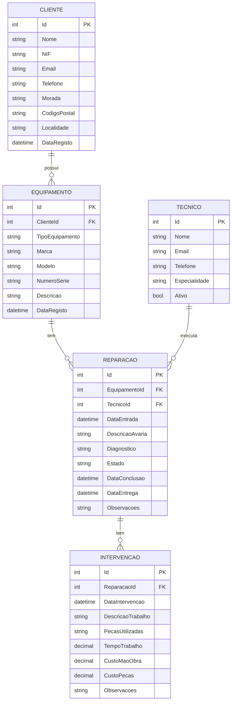

# TechRepair — Diagrama Entidade-Relação

## Diagrama ER (Mermaid)

## Entidades e Cardinalidades

| Relação | Cardinalidade | Descrição |
|---|---|---|
| Cliente — Equipamento | 1 : N | Um cliente possui vários equipamentos. |
| Equipamento — Reparacao | 1 : N | Um equipamento pode ter várias reparações. |
| Tecnico — Reparacao | 1 : N | Um técnico pode estar associado a várias reparações. |
| Reparacao — Intervencao | 1 : N | Uma reparação pode ter várias intervenções técnicas. |
